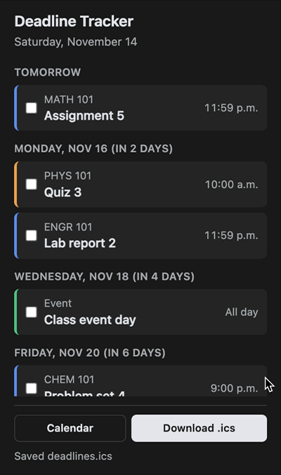

# Deadline Tracker

A Chrome extension that gathers my University of Waterloo deadlines from Learn and Crowdmark and puts them in one Google Calendar. I use it every day, and my Apple Calendar subscribes to that same calendar.

Since I used made-up data for this demo, there's no Sync now button. In the real extension, Sync now is to the left of Calendar.

## What it does

- Reads assignments, quizzes and course events from Learn and Crowdmark, using the logins already in Chrome
- Puts them in a separate "Deadlines" calendar in Google Calendar, so nothing touches my other events
- Updates an event when its due date changes, instead of making a copy
- Lets me tick a deadline as done. It gets crossed out, and the calendar event is marked "Done"
- Checks for new deadlines once an hour while Chrome is open
- Downloads the list as an .ics file for Apple Calendar or any other calendar app

## How it works

- The popup has a list of everything it found, a Sync now button, and a button that opens Google Calendar.
- Each site is read inside its own tab, so the extension uses the login already open in Chrome.
- Google sign-in uses Chrome's built-in sign-in. The extension asks for access only to the calendar it creates.
- Everything it saves stays on my computer, except the events it writes to Google Calendar.

## Privacy and permissions

- It never asks for, sees or stores a password.
- It only reads learn.uwaterloo.ca and app.crowdmark.com, and only writes to Google Calendar.
- No analytics, no tracking, and nothing is sent to anyone else.
- The full privacy policy is in [PRIVACY.md](PRIVACY.md).

## Project layout

- `extension/` is the extension itself: `manifest.json`, the popup, and the Learn, Crowdmark and Google code.
- `images/` holds the demo GIF for this README.
- `PRIVACY.md` is the privacy policy linked from the Chrome Web Store listing.

## Install from source

1. Clone this repo.
2. Open `chrome://extensions` and turn on Developer mode.
3. Click "Load unpacked" and pick the `extension/` folder.
4. Sign in to Learn and Crowdmark in Chrome, then open the extension and press Sync now.

## Built by

Hi, I am Arjun Garg. I am a Mechatronics student at the University of Waterloo. I built this to learn how Chrome extensions and Google's APIs work. It is not made by or connected to the University of Waterloo, D2L or Crowdmark.
